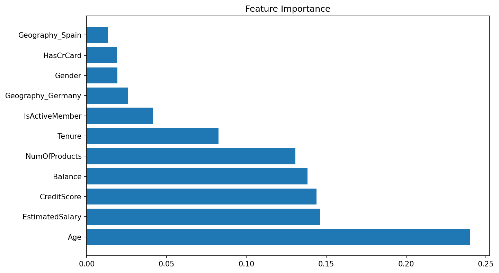

# 🏦 Bank Customer Churn Prediction (Python Project)

## 📌 Project Overview

This project builds machine learning models in Python to predict which bank customers are likely to leave, also called churn. It compares five classification models and tests whether new engineered features improve the results.

The dataset covers 10,000 customers of a European bank in France, Germany, and Spain. Of those, 2,037 customers (20.4%) left the bank. Because most customers stayed, the project looks beyond accuracy and focuses on **recall for churners**, which measures how many of the customers who actually left the model was able to catch.

## 🎯 Key Features

✅ Data Inspection: Checked data types, missing values, and duplicate rows. 
✅ Encoding: Converted Gender to 0/1 with `LabelEncoder` and Geography to dummy columns with `get_dummies`. 
✅ Feature Scaling: Standardized all features with `StandardScaler` so no feature dominates because of its units. 
✅ Train/Test Split: Held back 20% of customers (2,000) to test each model on data it had not seen. 
✅ Five-Model Comparison: Trained Random Forest, Gradient Boosting, Logistic Regression, SVM, and KNN. 
✅ Model Evaluation: Compared accuracy, confusion matrices, and churn recall for every model. 
✅ Feature Importance: Ranked which customer traits the Random Forest relied on most. 
✅ Feature Engineering: Added balance, age group, tenure group, product usage, and gender-by-country features, then retrained the model.

## 📷 Visualizations

### Feature Importance (Random Forest)

## 🗂️ Repository Files

| File | Description |
|------|-------------|
| `Churn_Modelling.csv` | Raw dataset: 10,000 rows and 14 columns of bank customer data |
| `churn_prediction_model.ipynb` | Jupyter Notebook with the full code, models, and outputs |
| `feature_importance.png` | Feature importance chart from the Random Forest model |

## 🧹 Data Preparation

- Loaded the data with `pd.read_csv()` using a relative file path, so the notebook runs from any computer.
- Confirmed the dataset has no missing values and no duplicate rows.
- Left out ID columns (`RowNumber`, `CustomerId`, `Surname`), since they do not describe customer behavior.
- Encoded `Gender` as 0/1 and turned `Geography` into `Geography_Germany` and `Geography_Spain`, with France as the baseline.
- Split the data 80/20 with `random_state=42` so results can be repeated.
- Scaled the features with `StandardScaler`, fitting only on the training set to avoid leaking test data into the model.

**Engineered features:**

- `BalanceZero`: whether the customer has a $0 balance
- `BalanceToSalaryRatio`: account balance divided by estimated salary
- `ProductUsage`: number of products multiplied by active member status
- `AgeGroup` and `TenureGroup`: age and tenure grouped into ranges
- `Male_Germany` and `Male_Spain`: gender combined with country

## 🛠️ Skills & Tools Applied

- Language and Environment: Python, Jupyter Notebook (Anaconda)
- Libraries: pandas, NumPy, Matplotlib, Seaborn, scikit-learn
- Models: Random Forest, Gradient Boosting, Logistic Regression, Support Vector Machine (SVM), K-Nearest Neighbors (KNN)
- Preprocessing: Label encoding, one-hot encoding, feature scaling, feature engineering
- Evaluation: Accuracy, precision, recall, F1-score, confusion matrix
- Data Storytelling: Explaining why accuracy alone can mislead on imbalanced data

## 📈 Business Questions Answered

This project provides insights into:

- Can we predict which customers will leave the bank?
- Which model catches the most customers who are about to leave?
- Which customer traits are most linked to churn?
- Do engineered features improve the model?

## 💡 Key Insights

### Model Comparison (2,000 test customers, 393 of whom left)

| Model | Accuracy | Churners Caught | Churn Recall | Churn Precision |
|---|---|---|---|---|
| Gradient Boosting | 86.8% | 192 of 393 | 49% | 75% |
| Random Forest | 86.8% | 185 of 393 | 47% | 76% |
| Random Forest + engineered features | 86.6% | 186 of 393 | 47% | 75% |
| KNN | 83.0% | 146 of 393 | 37% | 61% |
| Logistic Regression | 81.1% | 79 of 393 | 20% | 55% |
| SVM (linear) | 80.4% | 0 of 393 | 0% | 0% |

- **Gradient Boosting was the strongest model.** It tied Random Forest on accuracy (86.8%) but caught the most churners (192 of 393).
- **Accuracy alone can mislead.** The linear SVM scored 80.4% accuracy by predicting that no one would leave. It caught **0 churners**. Because about 80% of customers stayed, a model can look accurate while being useless for finding customers at risk.
- **Even the best model missed about half of the churners.** Recall of 47% to 49% means roughly 1 in 2 leaving customers went undetected. This is the main area to improve.
- **Feature engineering did not improve results.** Adding the new features kept accuracy at 86.6% and recall at 47%, so the original features already carried most of the signal.
- **Age was the most important feature,** well ahead of salary, credit score, balance, and number of products. Customers who left averaged **44.8 years old**, compared with **37.4** for those who stayed.

### Churn Patterns in the Data

- **Germany had double the churn rate** of the other countries: **32.4%**, compared with 16.2% in France and 16.7% in Spain.
- **Inactive members left almost twice as often:** **26.9%** churn, compared with **14.3%** for active members.
- **Number of products showed a sharp pattern.** Customers with 2 products had the lowest churn (**7.6%**). Churn jumped to **82.7%** for customers with 3 products, and **all 60** customers with 4 products left.
- **Female customers churned more often** (25.1%) than male customers (16.5%).

*Note: The feature importance chart comes from the first Random Forest model. Random Forest importance shows how much the model used each feature, not whether it raises or lowers churn, and it can favor features with many unique values, such as salary. The models used default settings and were not tuned. With only about 20% churners, techniques like class weighting or resampling would likely improve recall.*

## 🚀 Learning Outcomes

Building this project strengthened my skills in:

📌 Preparing categorical data with label encoding and one-hot encoding 
📌 Scaling features correctly without leaking test data 
📌 Training and comparing five classification models 
📌 Reading confusion matrices and recall on imbalanced data 
📌 Engineering new features and testing whether they help 
📌 Debugging notebooks so each cell runs once, in order, from a fresh kernel

## 🔮 Next Steps

- Use `class_weight='balanced'` or SMOTE to help the models catch more churners.
- Lower the prediction threshold to trade some precision for higher recall.
- Tune Gradient Boosting with `GridSearchCV` and use cross-validation instead of a single split.
- Add a ROC curve and AUC score to compare models across all thresholds.
- Use SHAP values to show whether each feature raises or lowers a customer's churn risk.

## 📚 Dataset Source

[Churn Modelling](https://www.kaggle.com/datasets/shrutimechlearn/churn-modelling/data) by shrutimechlearn on Kaggle.

## 🙌 Acknowledgment

This project taught me that the most accurate model is not always the most useful one. On imbalanced data, the real question is how many of the customers at risk the model can actually find.

## 🔗 Related Link

[LinkedIn Post](https://www.linkedin.com/feed/update/urn:li:activity:7525778442756308993/)

## 👨‍💻 Author

**Omar Shazley**: Data Analyst | Python, Excel, SQL, and healthcare data analytics

💼 [LinkedIn](https://www.linkedin.com/in/omar-shazley-914a16b1/) 
💻 [GitHub Portfolio](https://github.com/Bromar95) 
📧 Email: [omarshazley@gmail.com](mailto:omarshazley@gmail.com)

✨ If you like this project, don't forget to ⭐ star the repo!
